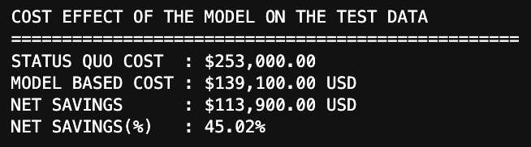

# IBM HR Attrition Analysis

End-to-end analysis of IBM HR data: EDA, attrition prediction model, and an interactive dashboard.

## Problem
Why do employees leave, and can we predict who is likely to?

## Dataset
IBM HR Analytics Employee Attrition dataset (Kaggle): 1,470 employees, 35 features.

## What I Did
- **Analysis:** explored the data to find what drives attrition
- **Prediction:** built a Logistic Regression model to predict who will leave
- **Dashboard:** built an interactive dashboard in Power BI

## Summary of Findings

### Problem
Employee attrition is concentrated among younger, overworked, and under compensated mid-level staff. Current turnover costs the organization **\$253,000** (assumed figures) on the holdout evaluation data alone, driven mainly by burnout, travel fatigue, and pay deficit.

### Approach
I built an interpretable risk-scoring model with financial threshold optimization (threshold = 0.45). By mapping model outputs to level-specific intervention costs and replacement expenses, retention resources go where the financial return is highest.

### Key Findings
- **Financial impact:** the model-driven strategy cuts total turnover cost from \$253,000 to \$139,100, a **45.02% reduction** (\$113,900 net savings).
- **Overtime is the biggest driver:** high-risk employees are 4.6x more likely to work overtime (49.39% vs 11.88%).
- **Business travel:** frequent travelers have 2.14x higher attrition odds (28.28% vs 11.55%).
- **Compensation gap:** high-risk employees earn 42.67% less per month (\$4,741 vs \$8,270 baseline), making them easy targets for external recruiters.

### Recommendations
1. **Targeted overtime caps:** review workloads for staff with consistent overtime, the single highest flight risk.
2. **Selective pay adjustment:** direct intervention budgets toward fixing salary compression for mid-30s employees in high-demand roles before they reach exit intent.
3. **Deployment strategy:** build the 0.45 probability threshold into HR systems to automatically trigger retention actions for flagged high-risk staff.

## Model Results (Test Set)
| Metric | Score |
|---|---|
| Model | Logistic Regression |
| Accuracy | 72.1% |
| Recall | 82.9% |

## Cost Effect of Model

## Dashboard

## Tools
Python, pandas, scikit-learn, Power BI
